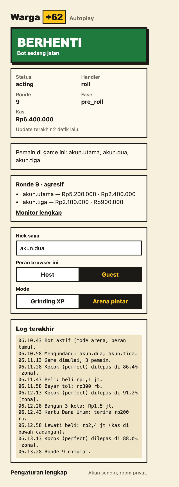
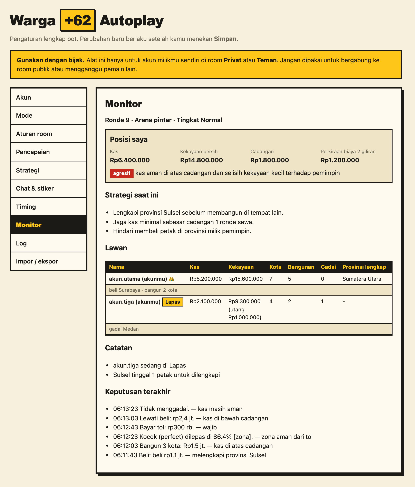
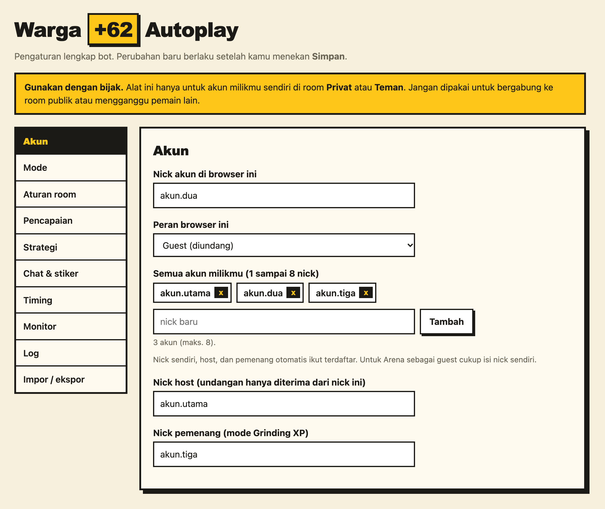
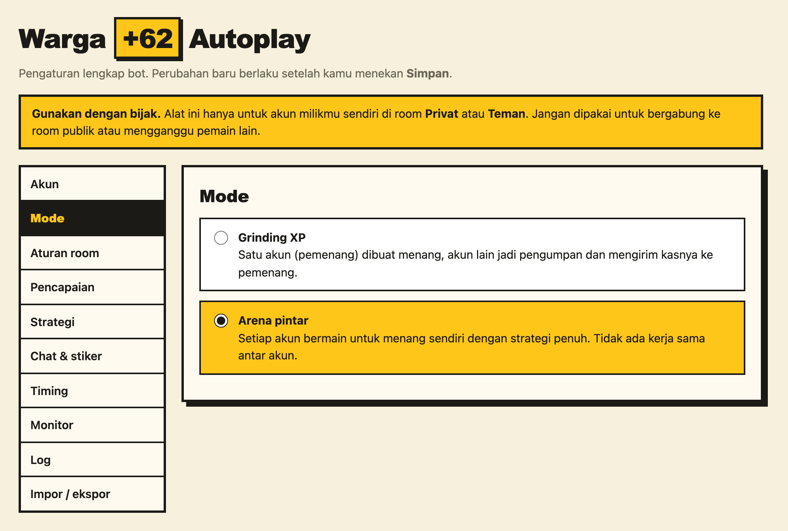
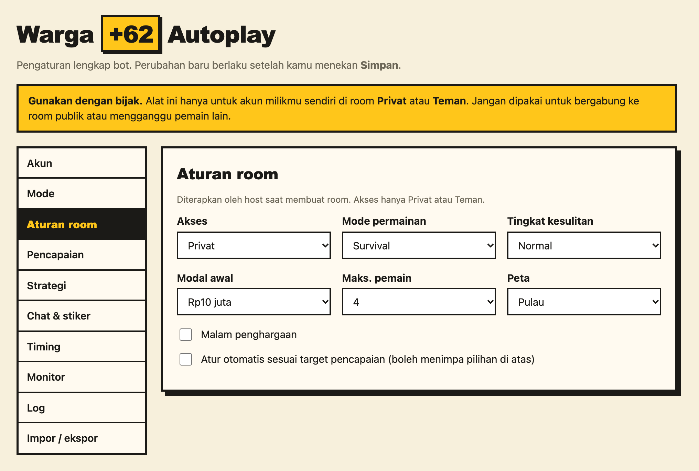
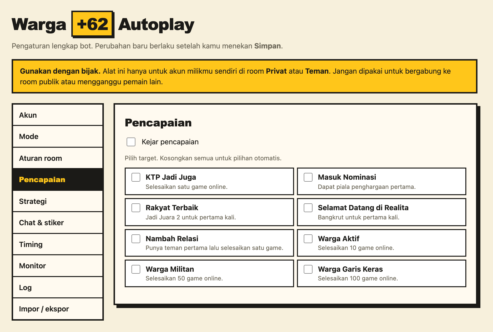
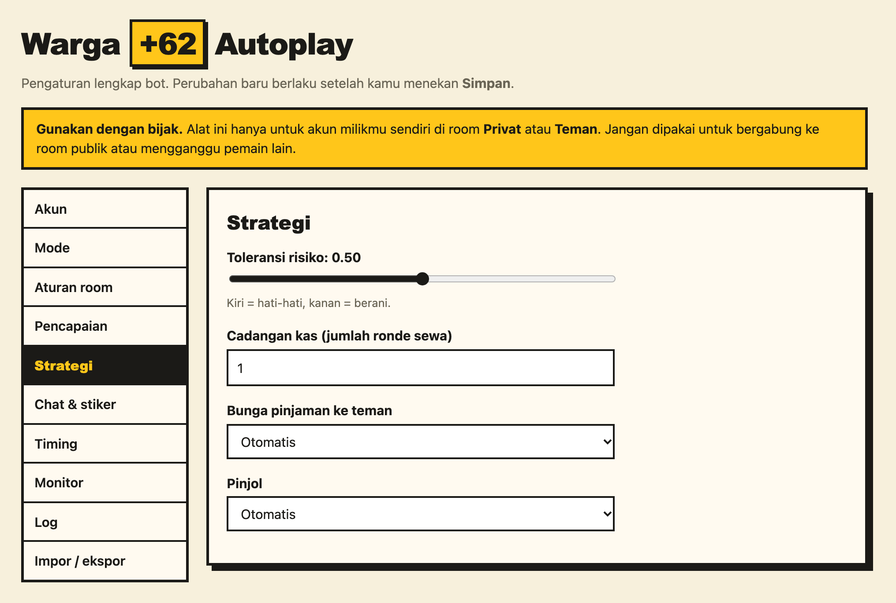
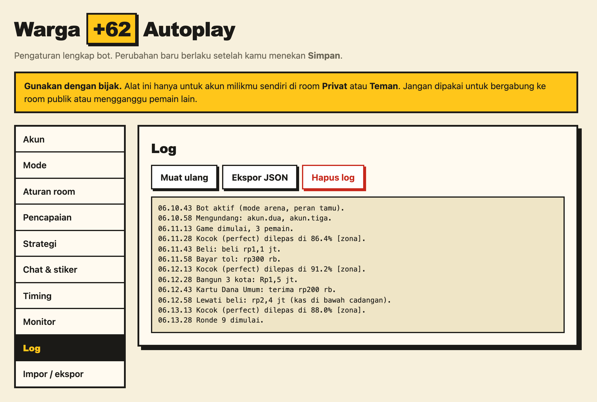

<p align="center">
  
</p>

# Warga +62 Autoplay

[](https://github.com/ilramdhan/warga62-autoplay/actions/workflows/ci.yml)
[](https://github.com/ilramdhan/warga62-autoplay/releases)


Bot auto-play untuk **[Warga +62](https://mainwarga62.id)**, game monopoli satir Indonesia. Bot ini mengurus satu pertandingan penuh: membuat room, mengundang akun-akunmu, mengocok dadu tepat di zona ★ Perfect, mengambil keputusan beli/bangun/gadai/pinjam, hingga memulai game berikutnya. Semua itu hanya untuk **akun milik sendiri di room Privat/Teman**.

> [!WARNING]
> **Gunakan dengan bijak.** Pakai hanya dengan akun-akun milikmu sendiri di room Privat atau Teman yang kamu buat. Jangan memakainya di room publik atau melawan pemain lain. Proyek ini tidak berafiliasi dengan developer Warga +62. Bot bisa melanggar ketentuan game dan berisiko membuat akun diblokir, dan risiko itu ditanggung sendiri. Dukung developernya: game ini dibuat oleh developer indie dan dibiayai donasi. Baca [docs/responsible-use.md](docs/responsible-use.md) dan [DISCLAIMER.md](DISCLAIMER.md) (penafian lengkap: tidak berafiliasi, risiko ditanggung pengguna, tanpa jaminan, privasi, dan permintaan dari developer game).

## Daftar isi

- [Fitur](#fitur)
- [Tampilan](#tampilan)
- [Mulai cepat](#mulai-cepat)
- [Dokumentasi](#dokumentasi)
- [Struktur](#struktur)
- [Kontribusi](#kontribusi)

## Fitur

### Mode bermain

| Mode             | Untuk apa                      | Cara kerja                                                                                                                                                                                                                                                                                        |
| ---------------- | ------------------------------ | ------------------------------------------------------------------------------------------------------------------------------------------------------------------------------------------------------------------------------------------------------------------------------------------------- |
| **Grinding XP**  | Mengumpulkan XP & menang cepat | Satu akun ditetapkan sebagai pemenang. Akun lain (pengumpan) mengirim kasnya ke pemenang, tidak membeli, lalu bangkrut sehingga game selesai cepat dan langsung diulang. Bawaan: Survival cepat.                                                                                                  |
| **Arena pintar** | Semua akun main untuk menang   | Tiap akun bermain sendiri-sendiri tanpa kerja sama: menjaga cadangan kas dari risiko sewa, melengkapi provinsi lalu membangun, ambil alih hanya untuk melengkapi/menggagalkan provinsi, pinjaman/Pinjol saat Gali Lubang. Mendukung semua tingkat (Santai–Krismon), Survival & Ronde, dan Krisis. |

Mode bisa diganti di tengah pertandingan. Penjelasan lengkap heuristiknya ada di [docs/strategy.md](docs/strategy.md).

### Otomatisasi permainan

- **Kocok ★ Perfect**: membaca posisi jarum di setiap frame dan melepas tepat di zona Perfect, tidak bergantung ukuran layar.
- **Semua modal ditangani**: kartu Takdir/Musibah/Krisis, kartu pilihan, gerbang tol, pengadilan, Lapas, bangun saat gajian, ambil alih, tukar tanah, permintaan uang, layar akhir (`Lewati N/M` → `Lanjut` → `Mulai lagi`).
- **Kartu simpanan**: Joki Dadu (ubah satu dadu bila hasilnya lebih baik), Pengacara, Orang Dalam, Voucher Tol, Flash Sale, Restu Ibu, dan lainnya dipakai sesuai situasi.
- **Keuangan**: kirim/minta uang, gadai & tebus gadai, bayar jaminan, bayar utang lebih awal, Gali Lubang (jual bangunan → gadai → pinjaman pemain → Pinjol → bangkrut hanya bila tak ada jalan lain), serta menawarkan pinjaman dengan bunga 0/10/25/50%.

### Room & undangan

- **Buat & atur room otomatis** lewat tombol _Atur_: akses, mode, batas ronde, tingkat, modal, jumlah pemain, peta, malam penghargaan. Akses selalu **Privat/Teman**.
- **Undang akun sendiri**: host membuka _Undang teman_, menunggu daftar teman termuat, lalu mengundang akun di daftarmu yang belum hadir. Guest menerima undangan hanya dari host.
- **Mulai otomatis** setelah semua akun hadir (atau setelah jendela undangan lewat).
- **Gabung di tengah game**: nyalakan bot kapan saja; cukup isi nick sendiri. Bot berhenti bila ada pemain yang bukan akunmu.

### Monitor & kontrol

- **Popup**: tombol MULAI/BERHENTI, status (handler, ronde, fase, kas), peran & mode, ringkasan lawan, dan log terakhir.
- **Monitor strategi**: posisi kas & cadangan, sikap bot (agresif/seimbang/bertahan), strategi yang sedang dipakai, kondisi tiap lawan (kas, kota, bangunan, provinsi, ancaman sewa, gaya main, tren), dan 15 keputusan terakhir beserta alasannya.
- **Perencana pencapaian** (opsional): memilih aturan room & perilaku untuk mengejar pencapaian di halaman Profil.
- **Chat & stiker** (opsional) di room sendiri.
- **Tahan banting**: watchdog, pemulihan error, penanganan AFK, modal macet ditutup otomatis.

### Dua cara menjalankan

- **Extension Chrome** (juga browser berbasis Chromium): popup kecil dan halaman Pengaturan.
- **Runner Playwright**: banyak akun sekaligus di latar belakang, tetap jalan walau jendela tertutup atau kamu memakai komputer untuk hal lain.

## Tampilan

> Tangkapan layar memakai data contoh (`npm run screenshots`).

<table>
  <tr>
    <td width="34%" valign="top">
      <b>Popup</b><br />
      Mulai/berhenti, status, peran & mode, ringkasan lawan, log.<br /><br />
      
    </td>
    <td valign="top">
      <b>Monitor strategi</b><br />
      Posisi saya, strategi saat ini, kondisi lawan, keputusan terakhir.<br /><br />
      
    </td>
  </tr>
</table>

<details>
<summary><b>Halaman Pengaturan (klik untuk melihat semua tab)</b></summary>

| Tab                                                                                                                              | Isi                                                                                                                   |
| -------------------------------------------------------------------------------------------------------------------------------- | --------------------------------------------------------------------------------------------------------------------- |
| **Akun** — nick akun ini, peran, daftar akunmu, host, pemenang<br />    | **Mode** — Grinding XP atau Arena pintar<br />               |
| **Aturan room** — preset yang diterapkan host lewat _Atur_<br /> | **Pencapaian** — target pencapaian (opsional)<br /> |
| **Strategi** — toleransi risiko, cadangan, bunga, Pinjol<br />  | **Log** — riwayat log bot<br />                                |

</details>

## Mulai cepat

### Opsi A: Extension Chrome

1. Unduh `warga62-autoplay-extension-v*.zip` dari [Releases](https://github.com/ilramdhan/warga62-autoplay/releases) (atau `npm run build`), lalu ekstrak.
2. Buka `chrome://extensions`, nyalakan **Developer mode**, klik **Load unpacked**, lalu pilih folder hasil ekstrak.
3. Ulangi di setiap profil Chrome. Satu profil berisi satu akun.
4. Klik ikon extension: isi **Nick saya**, pilih **Peran** (Host/Guest) dan **Mode**. Nick sendiri, host, dan pemenang otomatis ikut terdaftar sebagai akunmu; akun lain bisa ditambah di **Pengaturan lengkap**.
5. Buka mainwarga62.id di setiap profil, lalu tekan **MULAI** di popup. Mulai dari akun guest, baru host.

> Chrome menghentikan halaman yang di-minimize atau berada di tab belakang. Letakkan tiap jendela game di desktop terpisah dan jangan di-minimize, atau pakai Opsi B. Lihat [docs/troubleshooting.md](docs/troubleshooting.md).

Detail: [docs/extension.md](docs/extension.md)

### Opsi B: Runner Playwright (direkomendasikan untuk jalan di latar belakang)

```bash
git clone https://github.com/ilramdhan/warga62-autoplay.git
cd warga62-autoplay
npm ci
npx playwright install chromium
npm run build
cp src/runner/runner.config.example.json runner.config.json   # lalu edit nick akun
npm run runner -- login --account akun.utama                 # login manual sekali per akun
npm run runner -- login --account akun.dua
npm run runner -- run --config runner.config.json
```

Detail: [docs/runner.md](docs/runner.md)

## Dokumentasi

| Dokumen                                            | Isi                                   |
| -------------------------------------------------- | ------------------------------------- |
| [docs/architecture.md](docs/architecture.md)       | Arsitektur & kontrak modul            |
| [docs/strategy.md](docs/strategy.md)               | Cara bot mengambil keputusan          |
| [docs/achievements.md](docs/achievements.md)       | Pencapaian yang bisa diotomatisasi    |
| [docs/ui-labels.md](docs/ui-labels.md)             | Label tombol & fakta DOM game         |
| [docs/handlers.md](docs/handlers.md)               | Daftar handler modal                  |
| [docs/troubleshooting.md](docs/troubleshooting.md) | Masalah umum                          |
| [docs/responsible-use.md](docs/responsible-use.md) | Gunakan dengan bijak                  |
| [CLAUDE.md](CLAUDE.md)                             | Konteks proyek untuk AI & kontributor |

## Struktur

```text
src/core/        logika bot (dipakai extension & runner)
  handlers/      satu file per situasi layar
  strategy/      keputusan: grind, smart, risk, planner, insight (monitor)
  state/         baca state game & data turunan
  data/          data papan, kartu, pencapaian
src/extension/   Chrome extension MV3 (popup, options, bridge)
src/runner/      CLI Playwright
scripts/         build, validasi, ikon, screenshot
test/            node:test
docs/            dokumentasi & gambar
```

## Kontribusi

Lihat [CONTRIBUTING.md](CONTRIBUTING.md). Modal baru yang belum ditangani? Buka issue **New game modal** dan sertakan teks modal serta baris log `[W62]`. Semua kontribusi wajib mematuhi [aturan integritas](.claude/rules/game-integrity.md).

## Penafian

Proyek independen, tidak berafiliasi dengan developer Warga +62. Disediakan "sebagaimana adanya" tanpa jaminan; seluruh
risiko pemakaian (termasuk sanksi akun) ditanggung pengguna. Pemilik game yang keberatan dapat menghubungi lewat
[Issues](https://github.com/ilramdhan/warga62-autoplay/issues). Selengkapnya: [DISCLAIMER.md](DISCLAIMER.md).

## Lisensi

[MIT](LICENSE) © 2026 ilramdhan
